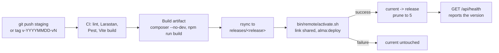

# Deployment

Alma deploys to any host that gives you **SSH, PHP 8.4, MySQL and a cron**: cPanel, Plesk, a VPS,
most managed WordPress hosts. Nothing runs on the server but PHP and WP-CLI. Dependencies and
assets are built in CI (or on your machine), uploaded with rsync, and activated by switching a
symlink, so a release goes live all at once and a bad one can be rolled back in a second.



## Server layout

One directory per environment (the *deploy root*), for example `/home/alma/production`:

```
production/
├── releases/
│   ├── 20261017093000-v-20261017-v1/   one complete release per deploy
│   └── 20261018101500-v-20261018-v1/
├── shared/
│   ├── .env          the environment file, created once by hand (never in git, never uploaded)
│   ├── uploads/      wp-content uploads, linked into every release as web/app/uploads
│   └── logs/         Acorn's logs, linked as web/app/cache/acorn/logs, kept across releases
└── current -> releases/20261018101500-v-20261018-v1
```

The web server's **document root is `current/web`**. On cPanel, set the domain's document root to
that path (Domains → Manage → Document Root), or replace `public_html` with a symlink:
`ln -s /home/alma/production/current/web ~/public_html` (move the old directory away first).

The repository root, `vendor/`, `.env` and `config/` sit *above* the document root and are never
web-reachable. The shipped `web/.htaccess` denies dotfiles, logs, dumps and Composer files inside it.

## One-time server setup

1. **PHP 8.4.** In cPanel's *MultiPHP Manager* (or *Select PHP Version*), pick 8.4 for the domain,
   with `pdo_mysql`, `mbstring`, `intl`, `gd` (or `imagick`), `zip` and `opcache`. Make sure the
   **CLI** PHP is 8.4 too (`php -v` over SSH); if it is not, find the 8.4 binary (cPanel:
   `/opt/cpanel/ea-php84/root/usr/bin/php`) and put it first on the PATH in `~/.bashrc`.
2. **WP-CLI.** `wp --info` over SSH. If it is missing:
   ```bash
   curl -O https://raw.githubusercontent.com/wp-cli/builds/gh-pages/phar/wp-cli.phar
   chmod +x wp-cli.phar && mkdir -p ~/bin && mv wp-cli.phar ~/bin/wp
   ```
   If `wp` lives somewhere unusual, set the `WP_CLI` variable on the GitHub Environment (or
   `<ENV>_WP` in `.env.deploy`) to its path.
3. **A database** and user (cPanel → *MySQL Databases*).
4. **The deploy root and `shared/.env`:**
   ```bash
   mkdir -p ~/production/{releases,shared/uploads,shared/logs}
   nano ~/production/shared/.env        # start from .env.example
   chmod 600 ~/production/shared/.env
   ```
   Set `WP_ENV=production`, `WP_HOME`, the database credentials, fresh salts and an `APP_KEY`
   (generate both locally: `php bin/lib/env.php secrets /tmp/scratch.env`, then copy the values).
   **Do not set `APP_VERSION`**: each release writes its own (see below).
5. **An SSH key for deploys.** Generate a dedicated key pair (no passphrase) and authorise it on
   the server:
   ```bash
   ssh-keygen -t ed25519 -f alma-deploy -C "alma deploy" -N ""
   ssh-copy-id -i alma-deploy.pub alma@example.com     # or cPanel → SSH Access → Import Key
   ssh-keyscan -p 22 example.com                        # this output is SSH_KNOWN_HOSTS
   ```

## Deploying from GitHub Actions

`.github/workflows/deploy.yml` runs CI first (the same jobs as on a pull request), then builds and
ships. Each target is a **GitHub Environment** (Settings → Environments) with its own values:

| Name | Kind | Value |
| :--- | :--- | :--- |
| `SSH_PRIVATE_KEY` | secret | contents of `alma-deploy` (the private key) |
| `SSH_KNOWN_HOSTS` | secret | output of `ssh-keyscan` for the host |
| `SSH_HOST`, `SSH_USER` | secret | e.g. `example.com`, `alma` |
| `SSH_PORT` | secret | optional, default 22 |
| `DEPLOY_PATH` | secret | the deploy root, e.g. `/home/alma/production` |
| `SITE_URL` | variable | e.g. `https://example.com`, for the health check and the run link |
| `WP_CLI` | variable | optional path to WP-CLI on the server |

Repository-level: `ACF_PRO_KEY` (secret), `ACF_PRO_SITE_URL` (variable, a site URL registered to
the license) and, optionally, `SLACK_WEBHOOK_URL` (secret) for a deploy notification.

| Trigger | Environment | `APP_VERSION` |
| :--- | :--- | :--- |
| push to the `staging` branch | `staging` | the short commit SHA |
| tag `v-YYYYMMDD-vN` (e.g. `v-20261017-v1`, then `-v2` for a second release that day) | `production` | the tag |

Give the `production` environment **required reviewers**, so a tag waits for approval.

```bash
git tag v-20261017-v1 && git push origin v-20261017-v1
```

## Deploying from your machine

`bin/deploy` does exactly what the workflow does. It exports `HEAD` to a temporary directory
(uncommitted changes never ship), builds it, uploads and activates:

```bash
cp .env.deploy.example .env.deploy     # once: hosts, users, paths, URLs (gitignored)
bin/deploy staging
bin/deploy production --version v-20261017-v1
```

## What activation does

`bin/remote/activate.sh` runs on the server, inside the uploaded release:

1. Links `shared/.env`, `shared/uploads` and `shared/logs` into the release.
2. Writes the release's version to `<release>/.env.local` and `<release>/VERSION`. Bedrock loads
   `.env.local` over `.env`, so each release reports its own version, including after a rollback.
3. Runs **`wp acorn alma:deploy`** against the release, under a MySQL lock so two deploys never
   overlap:
   - `migrate --force`: **fatal**, so a failing migration stops the deploy;
   - every module's deploy tasks (settings-as-code, seeders), each idempotent and non-fatal;
   - a soft rewrite-rules flush;
   - `optimize:clear` + `view:cache`, so the first visitor does not compile Blade.

   If this exits non-zero, `current` is not touched and the previous release keeps serving.
4. Points `current` at the release with an atomic rename (`mv -T`).
5. Deletes all but the newest five releases (never the live one).

Migrations run while the previous release is still live, so write them to be **backward compatible
for one release**: add columns and tables first, drop them in a later release. That is also what
makes a rollback safe.

## Rollback

```bash
bin/rollback production                  # back one release
bin/rollback production --release 20261017093000-v-20261017-v1
```

Only the symlink moves. Database changes are not reversed (see above).

## OPcache and the realpath cache

A new release lives at a new path, so OPcache compiles it fresh; nothing needs resetting. PHP's
**realpath cache** can still resolve `current` to the previous release for up to
`realpath_cache_ttl` (120 s by default), so for a minute or two some requests may be served by the
old code. That is why the post-deploy health check retries for up to three minutes. If the host
lets you, lower `realpath_cache_ttl` to a few seconds in the domain's PHP settings.

## Cron

WordPress' scheduled tasks (lead retention, log pruning, cron health, anything a plugin schedules)
need a real cron. Visitor-triggered WP-Cron stalls on a quiet site, and Tools → Site Health and
`/api/health/checks` report a stalled scheduler.

1. In cPanel → *Cron Jobs*, every 5 minutes:
   ```
   */5 * * * * cd /home/alma/production/current && wp cron event run --due-now --quiet >/dev/null 2>&1
   ```
   (Use the full path to `php`/`wp` if cron's PATH differs from your shell's.) Bedrock reads `.env`
   itself, so this needs no environment. If a host has no WP-CLI in cron, use
   `curl -s https://example.com/wp/wp-cron.php > /dev/null`, with **no `?doing_wp_cron`**
   parameter, which turns every tick into a silent no-op.
2. Wait for one tick and check it worked: `wp cron event list` shows nothing overdue, and Site Health
   reports cron as healthy.
3. **Only then** set `DISABLE_WP_CRON=true` in `shared/.env`. Setting it before the cron works stops
   scheduled tasks entirely.

Optional, only if you set `QUEUE_CONNECTION=database`, to drain deferred jobs every minute:

```
* * * * * cd /home/alma/production/current && wp acorn queue:work --stop-when-empty --max-time=50 --quiet >/dev/null 2>&1
```

With the default `QUEUE_CONNECTION=sync`, deferred work (notification emails, webhooks) runs right
after each response and needs no cron.

## Pulling production data to your machine

```bash
bin/pull production                # database + uploads (backs up your local database first)
bin/pull production --no-uploads
```

The pull refuses to run if your local `WP_ENV` is production, rewrites URLs serialisation-safely,
and runs `wp acorn alma:deploy` locally. Production settings can point at live integrations (a lead
webhook, notification recipients): list those option names in `ALMA_PULL_SCRUB_OPTIONS` in
`.env.deploy` so they are deleted after every pull. `bin/pull` needs the `mysql`/`mysqldump`
clients on your PATH.

`bin/backup production` streams the remote database and uploads into `backups/` (gitignored).
Take one before any risky release, and keep host-level backups as well: they are the real
disaster-recovery copy.

## Launch checklist

- [ ] `WP_ENV=production` and `DISALLOW_INDEXING` unset (or `false`) in `shared/.env`.
- [ ] `MAIL_HOST` and the other SMTP settings set, and a test lead notification received.
- [ ] `SENTRY_LARAVEL_DSN` set, and a test error visible in Sentry with the right release.
- [ ] `HEALTH_TOKEN` set, and an uptime monitor on `/api/health` (and `/api/health/checks` with
      the `X-Health-Token` header).
- [ ] The cron is verified *before* `DISABLE_WP_CRON=true` (see Cron).
- [ ] HTTPS works and `WP_HOME` is `https://…`.
- [ ] `ACF_PRO_KEY` set (license activation) and ACF Pro is in `composer.lock`.
- [ ] Lead notification recipients and the webhook configured (wp-admin → Leads → Settings or `.env`).
- [ ] A page cache, if the host has one (LiteSpeed Cache, for example), must **never cache a
      response that sets a cookie**, and must bypass `/wp-admin`, `/wp-login.php`, `/wp-json`,
      `/livewire` and `/api`. A cached `Set-Cookie` shares one visitor's session with everyone.
- [ ] A host-level backup schedule exists, and one restore has been practised on staging.
