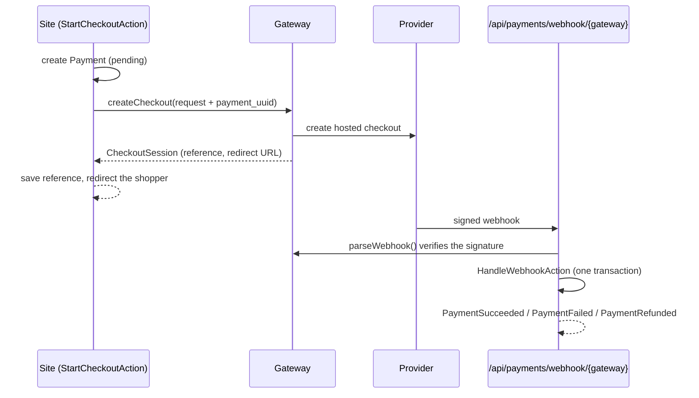

# Payments

The Payment module is a **gateway-agnostic** foundation:

- a standalone checkout (a deposit, a booking fee, a paid download);
- a webhook endpoint that fails closed;
- idempotent event handling;
- events other modules listen to;
- an optional bridge to the WooCommerce checkout.

It ships one gateway, `fake`, which has no provider behind it. Real gateways (Wompi, Stripe,
Mercado Pago, ...) are added per project.

The module is **optional**: it registers only when `PAYMENTS_ENABLED=true`.

## The flow



Starting a checkout from your own code (a Livewire component or a controller):

```php
use App\Domains\Payment\Actions\StartCheckoutAction;
use App\Domains\Payment\Data\CheckoutRequest;
use App\Domains\Payment\Data\Money;

$started = app(StartCheckoutAction::class)->execute(new CheckoutRequest(
    amount: Money::fromDecimal('49.00', 'USD'),
    description: 'Consultation deposit',
    customerEmail: $email,
    successUrl: home_url('/thank-you/'),
    cancelUrl: home_url('/book/'),
    leadUuid: $lead->uuid ?? null,   // optional soft link to the Lead module
));

return redirect()->away($started->redirectUrl());
```

React to outcomes with listeners in any module's provider. Anything that calls a third party
belongs in `$listenAfterResponse`:

```php
protected array $listenAfterResponse = [
    \App\Domains\Payment\Events\PaymentSucceeded::class => [SendReceipt::class],
];
```

## Money

Amounts are `Money`: integer minor units plus an ISO 4217 currency. Never use floats.

- `Money::fromDecimal('12.50', 'USD')` parses the digits directly.
- It refuses more decimals than the currency allows, unless you pass `round: true`.
- Zero-decimal (JPY, CLP) and three-decimal (KWD) currencies are handled.
- `toDecimal()` gives the exact string providers expect.
- `format()` is for display only.

## Adding a gateway

Example: Wompi.

1. **Implement the contract** in `app/Domains/Payment/Gateways/WompiGateway.php`, implementing
   `App\Domains\Payment\Contracts\PaymentGateway`:
   - `isConfigured()` returns false unless every key it needs is present.
   - `createCheckout()` calls the provider and returns a `CheckoutSession`:
     - `reference` is the provider's ID for the payment;
     - `redirectUrl` is used for a hosted checkout, `clientSecret` for an embedded one;
     - send `$request->metadata['payment_uuid']` to the provider if it accepts metadata.
   - `parseWebhook()` verifies the provider's signature with the provider's own scheme, then
     returns a `PaymentEvent` with a stable unique `eventId` (used for idempotency), the
     `reference`, the amount when the provider sends one, and the payload.
   - Throw `InvalidSignature` for anything you cannot verify.
   - Use `Illuminate\Support\Facades\Http` with an explicit timeout so tests can fake it.
   - Implement `RefundsPayments` too if the site should issue refunds.
2. **Register the driver** in `PaymentServiceProvider::register()` (or a project provider):
   ```php
   $this->app->afterResolving(GatewayManager::class, fn (GatewayManager $manager) =>
       $manager->extend('wompi', fn ($app, array $config) => new WompiGateway($config)));
   ```
   The driver receives its own config block, with `key` added.
3. **Configure it** in `config/payments.php` (an example is commented there) and `.env`:
   ```php
   'wompi' => [
       'driver' => 'wompi',
       'public_key' => env('WOMPI_PUBLIC_KEY'),
       'private_key' => env('WOMPI_PRIVATE_KEY'),
       'events_secret' => env('WOMPI_EVENTS_SECRET'),
   ],
   ```
   Then add every new variable to `.env.example` and blank it in `phpunit.xml`.
4. **Point the provider's webhook** at `https://<site>/api/payments/webhook/wompi`.
5. **Test it**:
   - fake the provider's API with `Http::fake()` (the suite refuses real requests);
   - build signed webhook requests the way the provider signs them;
   - reuse the scenarios in `tests/Feature/Payment/WebhookControllerTest.php`.

`PAYMENTS_GATEWAY` sets which gateway `StartCheckoutAction` uses when none is named.

## Webhook security

`POST /api/payments/webhook/{gateway}` (stateless `api` group, so no session and no CSRF):

| Situation | Response |
| :--- | :--- |
| Gateway not listed in `config/payments.php` | **404** |
| Gateway listed but missing credentials (`isConfigured()` false) | **503**: it fails closed and never trusts an unverifiable payload |
| Signature missing, wrong or outside the tolerance window | **403**: nothing is recorded |
| Event already handled | **200** `{"status":"duplicate"}`, which stops provider retries |
| Verified, but changes nothing (unknown reference, invalid transition, amount mismatch) | **200** `{"status":"ignored"}` |
| Applied | **200** `{"status":"processed"}` |

For gateways that sign with a shared secret, `Support\WebhookSignature` implements the common
`t=<timestamp>,v1=<hmac>` scheme:

- HMAC-SHA256 over `timestamp.body`;
- a 300-second tolerance, which defeats replays;
- constant-time comparison;
- several `v1` values accepted during secret rotation;
- an empty secret never verifies.

## Idempotency and status transitions

`HandleWebhookAction` runs in one database transaction:

1. Record the provider event in `alma_payment_events`, where `(gateway, event_id)` is unique.
2. Apply the status change to the payment.
3. Run synchronous listeners.

If a listener throws, everything rolls back and the endpoint answers 500. The provider retries,
and the retry is processed normally. Two concurrent deliveries of the same event collide on the
unique key, and the loser answers `duplicate`.

Allowed transitions (`PaymentStatus::canTransitionTo()`):

| From | To |
| :--- | :--- |
| pending | succeeded, failed |
| failed | succeeded (asynchronous methods that settle late) |
| succeeded | refunded |

Anything else is ignored. A late or replayed "failed" can never undo a success.

A "succeeded" event whose amount differs from the payment's is **not** marked paid. It is
logged as a warning for someone to look at.

## The fake gateway

The default gateway works with zero setup, outside production only:

- `StartCheckoutAction` redirects to a signed local page, `/payments/fake/{reference}`, with
  **Pay** and **Decline** buttons.
- The confirm step builds a signed webhook and sends it through the same verification and
  handling as a real provider. The whole pipeline therefore runs end to end, then the shopper
  returns to the success or cancel URL.
- In production `FakeGateway::available()` is false: the gateway reports itself unconfigured,
  its webhook answers 503 and its pages are not registered at all.
- Its signing secret is `PAYMENTS_FAKE_SECRET`, or one derived from `APP_KEY`.

## WooCommerce bridge

When the Commerce module is active, a Payment-module gateway can also appear at the WooCommerce
checkout:

```php
namespace App\Domains\Payment\WooCommerce\Gateways;

use App\Domains\Payment\WooCommerce\WooCommerceGatewayBridge;

class WompiWooCommerceGateway extends WooCommerceGatewayBridge
{
    protected function gatewayKey(): string
    {
        return 'wompi';
    }
}
```

List the class in `config('payments.woocommerce.gateways')`, then enable it under WooCommerce →
Settings → Payments. How it works:

- `process_payment()` starts a checkout for the order total, rounded half up to the currency.
- The order ID is stored in the payment's metadata, and the payment UUID in the order meta
  (`_alma_payment_uuid`).
- The shopper is redirected to the gateway.
- When the webhook arrives, `SyncWooCommerceOrder` (synchronous, inside the webhook
  transaction) completes, fails or refunds the order.
- The method is hidden while the gateway lacks credentials.

The bridge covers hosted (redirect) checkouts. Embedded card fields, tokenised saved cards and
WooCommerce Blocks checkout support are left to the concrete gateway.

## Data

- **`alma_payments`:**
  - `uuid`, `gateway`, `reference` (unique per gateway), `status`;
  - `amount_minor`, `currency`, `description`, `customer_email`, `customer_name`;
  - `metadata` (JSON), `lead_uuid` (a soft link to the Lead module, no foreign key, because
    Lead is optional);
  - `success_url`, `cancel_url`, `failure_reason`, `paid_at`, `refunded_at`.
- **`alma_payment_events`:** one row per provider event ever handled (`gateway`, `event_id`,
  `type`, `payment_id`, `payload`).

Both are created by `wp acorn alma:deploy` (the module's migrations), with the WordPress table
prefix.

## Configuration

| Variable | Default | Purpose |
| :--- | :--- | :--- |
| `PAYMENTS_ENABLED` | `false` | Register the module. |
| `PAYMENTS_GATEWAY` | `fake` | Gateway used when none is named. |
| `PAYMENTS_CURRENCY` | `USD` | Currency for amounts given without one (`CheckoutRequest::fromArray`). |
| `PAYMENTS_FAKE_SECRET` | *(derived from `APP_KEY`)* | Signing secret for the fake gateway. |
